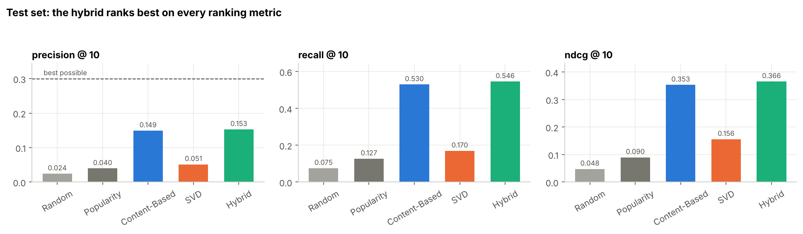
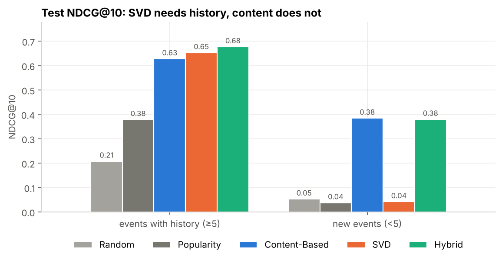

# Event Recommendation System — Content-Based, SVD & Hybrid

A complete, documented recommender-system pipeline in Python that suggests upcoming events (concerts, workshops, meetups, hikes…) to users based on their interests and past behaviour. It compares **content-based filtering** (TF-IDF + cosine similarity), **collaborative filtering with SVD**, and a **hybrid** of the two, using a leakage-free time-based evaluation.

Based on a B.Sc. graduation project (*Event Recommendation System*, Computer Science, Nile University, 2025), rebuilt from scratch as a reproducible ML pipeline.



## Results (test set: Sep–Dec 2025, never used for tuning)

**Top-10 ranking** — recommend 10 of the ~135 events happening in the test period; a hit = the user later marked the event *going* or *attended*.

| Model | Precision@10 | Recall@10 | NDCG@10 (95% CI) |
|---|---|---|---|
| Random | 0.024 | 0.075 | 0.048 [0.042, 0.054] |
| Popularity | 0.040 | 0.127 | 0.090 [0.081, 0.099] |
| Content-Based | 0.149 | 0.530 | 0.353 [0.339, 0.367] |
| SVD (PureSVD) | 0.052 | 0.170 | 0.156 [0.143, 0.169] |
| **Hybrid** | **0.153** | **0.546** | **0.366** [0.352, 0.380] |

Users attended 3.2 test events on average, so the **best possible Precision@10 is 0.30**. The hybrid's gain over content-based is small but real: paired bootstrap 95% CI for the NDCG@10 difference = [+0.006, +0.019].

**Rating prediction** — predict the 1–5 stars of attended events.

| Model | MAE | RMSE | RMSE vs global mean |
|---|---|---|---|
| Global mean | 0.834 | 0.986 | — |
| Content-Based (item-kNN) | 0.783 | 0.955 | −3.1% |
| **SVD (Funk SVD with biases)** | **0.782** | **0.949** | **−3.7%** |

## Key findings

1. **Events are a cold-start problem.** An event is only "alive" for ~3 weeks before it starts, so 81% of the events users attended in the test period had *no* interactions at the moment of recommendation. Collaborative filtering cannot rank those — content features can.
2. **SVD is strong where history exists.** On test events with ≥5 earlier interactions, SVD (NDCG 0.65) beats content-based filtering (0.63), and the hybrid is best (0.68). Its event factors rediscover the 8 categories without ever reading text ([notebook 06](notebooks/06_collaborative_svd.ipynb)).
3. **How you hybridise matters.** A *switching* hybrid (use SVD as soon as an event has any history) is worse than content alone; weighted blends are better. The design and weights were chosen on a separate validation period.
4. **Ratings are hard on a young platform.** Most users have few ratings, so the gain over the global mean is modest overall, but it grows steadily with each user's rating history ([chart](reports/figures/rating_by_history.png)).
5. **Personalisation spreads attention.** Content-based and hybrid lists cover 100% of candidate events; popularity shows the same 17% to everyone.



## About the data (please read)

The dataset is **synthetic**. No public event dataset combines user interests, event descriptions, interaction history *and* ratings (the best-known one, Kaggle's 2013 Event Recommendation Engine Challenge, has no event text or ratings and cannot be redistributed). Instead of random data, [`00_generate_dataset.ipynb`](notebooks/00_generate_dataset.ipynb) simulates people with hidden tastes:

- true category preferences (stated interests are only partly honest), a hidden style (beginner↔advanced, calm↔energetic, budget↔premium), home city, willingness to travel, price sensitivity, activity level and rating habit;
- events with text, category, city, price, venue and hidden quality;
- behaviour sampled from those tastes with noise: view → interested → going → attended, plus 1–5 ratings;
- a small, documented amount of messy data (duplicates, impossible ages, inconsistent city names, missing values).

The hidden tastes are **never saved** — models only see the CSV files. The results show that the pipeline learns real structure under realistic conditions; they are **not** claims about real users.

| File | Rows | Columns |
|---|---|---|
| `users.csv` | 2,000 | user_id, age, city, interests, signup_date |
| `events.csv` | 800 | event_id, title, description, category, tags, city, venue_type, start_datetime, price, organizer_id |
| `interactions.csv` | 50,518 | user_id, event_id, timestamp, interaction_type, rating |

7 Egyptian cities · 8 categories · Jan 2024 – Dec 2025 · 97% sparse · seed 42 (fully reproducible).

## Method

| Step | What we do |
|---|---|
| **Split** | Global time split — train ≤ 1 Jul 2025, validation Jul–Aug, test Sep–Dec. No random split, so no model sees the future. |
| **Tuning** | Every hyperparameter is chosen on validation; the test set is used once, after re-training on train + validation. |
| **Content-Based** | Event vector = TF-IDF (unigrams + bigrams) of category, tags, title and description + one-hot category, city and price bucket, combined with weights. User profile = engagement-weighted average of their events (a 1-star rating pushes the profile away), blended with stated interests + home city; history takes over as it grows. Score = cosine similarity. |
| **SVD — ratings** | Funk SVD: `r̂ = μ + b_u + b_e + p_u·q_e`, trained with SGD on observed ratings only, regularisation and early stopping. |
| **SVD — ranking** | PureSVD: truncated SVD of the user × event engagement matrix (view 1 … attended 4). |
| **Hybrid** | Per-user min-max scaling, then `a·SVD + (1 − a)·CBF`. A static weight and a history-based confidence weight `a = w·n_e/(n_e + k)` were compared on validation (statistically tied); the best validation setting is used. |
| **Metrics** | MAE, RMSE, Precision@10, Recall@10, NDCG@10, bootstrap confidence intervals, catalog coverage, breakdowns by user and event history. |

## Notebooks

Each notebook explains the code line by line, the ML concepts in plain language, and ends with interview-style questions. Outputs are saved, so they can be read on GitHub without running anything.

| # | Notebook | Open in Colab |
|---|---|---|
| 00 | [Dataset generator](notebooks/00_generate_dataset.ipynb) | [](https://colab.research.google.com/github/Abdelrahman2115/recommender-system/blob/main/notebooks/00_generate_dataset.ipynb) |
| 01 | [Introduction, problem definition & data loading](notebooks/01_introduction_and_data_loading.ipynb) | [](https://colab.research.google.com/github/Abdelrahman2115/recommender-system/blob/main/notebooks/01_introduction_and_data_loading.ipynb) |
| 02 | [Exploratory data analysis](notebooks/02_eda.ipynb) | [](https://colab.research.google.com/github/Abdelrahman2115/recommender-system/blob/main/notebooks/02_eda.ipynb) |
| 03 | [Cleaning & time-based split](notebooks/03_cleaning_and_split.ipynb) | [](https://colab.research.google.com/github/Abdelrahman2115/recommender-system/blob/main/notebooks/03_cleaning_and_split.ipynb) |
| 04 | [Feature engineering (TF-IDF, one-hot, sparse matrices)](notebooks/04_feature_engineering.ipynb) | [](https://colab.research.google.com/github/Abdelrahman2115/recommender-system/blob/main/notebooks/04_feature_engineering.ipynb) |
| 05 | [Content-based filtering](notebooks/05_content_based.ipynb) | [](https://colab.research.google.com/github/Abdelrahman2115/recommender-system/blob/main/notebooks/05_content_based.ipynb) |
| 06 | [Collaborative filtering with SVD](notebooks/06_collaborative_svd.ipynb) | [](https://colab.research.google.com/github/Abdelrahman2115/recommender-system/blob/main/notebooks/06_collaborative_svd.ipynb) |
| 07 | [Hybrid recommendation](notebooks/07_hybrid.ipynb) | [](https://colab.research.google.com/github/Abdelrahman2115/recommender-system/blob/main/notebooks/07_hybrid.ipynb) |
| 08 | [Evaluation, final recommendations & conclusions](notebooks/08_evaluation_and_conclusions.ipynb) | [](https://colab.research.google.com/github/Abdelrahman2115/recommender-system/blob/main/notebooks/08_evaluation_and_conclusions.ipynb) |

## Project structure

```
recommender-system/
├── data/raw/                  # users.csv, events.csv, interactions.csv
├── notebooks/                 # 00–08, run in order (each one also runs on its own)
├── src/
│   ├── generate_dataset.py    # script version of notebook 00
│   └── recsys/                # reusable code used by the notebooks
│       ├── data.py            # loading, cleaning, time split
│       ├── features.py        # TF-IDF + one-hot event vectors
│       ├── models.py          # baselines, Content-Based, FunkSVD, PureSVD, hybrids
│       ├── metrics.py         # MAE, RMSE, Precision@k, Recall@k, NDCG@k
│       ├── evaluation.py      # ranking task, evaluation loop, bootstrap CI
│       ├── params.py          # stores hyperparameters chosen on validation
│       └── plotting.py        # shared chart style
├── reports/
│   ├── best_params.json       # tuned settings (written by notebooks 05–07)
│   ├── ranking_results.csv
│   ├── rating_results.csv
│   └── figures/
└── requirements.txt
```

The notebooks explain the code step by step; `src/recsys` stores the same implementation once, so every notebook uses identical logic (notebooks 03, 05, 06 and 07 check that their step-by-step versions give exactly the same results as the package).

## How to run

**Google Colab (no setup):** click a badge above and choose *Runtime → Run all*. The first cell clones this repository, so data and code are available automatically.

**Locally:**
```bash
git clone https://github.com/Abdelrahman2115/recommender-system.git
cd recommender-system
pip install -r requirements.txt
jupyter notebook notebooks/
```
Run the notebooks in order the first time (05–07 write the tuned settings that 06–08 read; a copy is already committed in `reports/best_params.json`). The full pipeline runs in about 3 minutes on a laptop CPU.

## Limitations and next steps

- **Synthetic data** — the natural next step is running the same notebooks on real platform logs (only notebook 00 would change).
- **Offline evaluation only** — logged behaviour depends on what users were shown; a live A/B test is the real measure.
- **Scale** — 800 events are scored exhaustively; a large catalogue would need approximate nearest-neighbour search.
- **Future work** — implicit-feedback models built for ranking (ALS, BPR, LightFM), learning-to-rank on top of both models' scores, travel distance and day-of-week features, user-facing explanations, group recommendations, and a small web demo.

## Tech stack

Python · pandas · NumPy · SciPy (sparse matrices) · scikit-learn (TF-IDF, one-hot encoding, truncated SVD, t-SNE) · Matplotlib · Google Colab. Funk SVD is implemented from scratch in NumPy.
